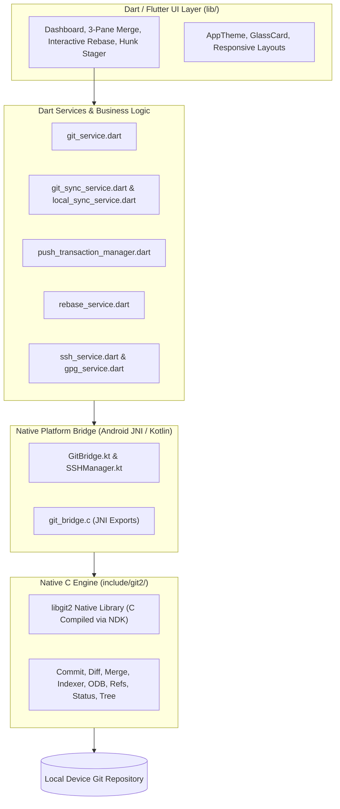

# GitLane: Systems Architecture & Technical Case Study

**Repository**: [GitLane](file:///d:/Alive/Practice/github/GitLane)  
**Project Category**: Group Engineering Project  
**Platform**: Android Mobile Application (Desktop-Grade Git Experience)  
**Core Technologies**: C (`libgit2`), Native C Bridge (JNI / NDK), Kotlin, Dart, Flutter Framework  

---

## 🌌 1. Executive Summary & Product Vision

**GitLane** is a flagship Android Git client designed to bring desktop-class Git capability to mobile devices. Most mobile Git apps are restricted to basic GitHub REST API calls (reading issues or creating pull requests). 

GitLane differs fundamentally: **it executes real, low-level Git plumbing operations locally on the mobile device's filesystem** by embedding a compiled **Native C library (`libgit2`)** through a custom **C / JNI Bridge**.

---

## 🏗️ 2. Architectural Deep-Dive

GitLane utilizes a high-performance **3-Tier Architecture**:

### Layer 1: The Native C Engine (`libgit2`)
* Located at: `gitlane/android/app/src/main/cpp/include/git2/` (94+ C header files)
* Directly compiles the C-based `libgit2` engine via the Android NDK (Native Development Kit).
* Bypasses heavy shell overhead, interacting directly with Git's object database (`odb.h`), reference database (`refdb.h`), and packfiles (`pack.h`).

### Layer 2: The Native JNI & Kotlin Bridge
* Located at: `gitlane/android/app/src/main/cpp/git_bridge.c` and `gitlane/android/app/src/main/kotlin/com/example/gitlane/GitBridge.kt`
* Maps Flutter Platform Channel invocations into low-level C functions.
* Manages memory allocations and thread safety when reading large commit histories or diffing dense hunks.
* **`SSHManager.kt`**: Handles on-device RSA/ED25519 cryptographic key generation and SSH agent communication.

### Layer 3: Flutter / Dart Application Layer
* Located at: `gitlane/lib/` (49 Dart source files)
* Features customized developer workflows and stateful services (`push_transaction_manager.dart`, `rebase_service.dart`, `indexer_service.dart`).

---

## 🛡️ 3. Key Advanced Engineering Features

### A. 3-Pane Visual Merge Conflict Resolver
* **File**: `gitlane/lib/ui/screens/merge/merge_resolution_screen.dart` & `visual_merge_editor.dart`
* **How it works**: Displays a side-by-side comparison of **Local (Ours)**, **Base (Ancestor)**, and **Incoming (Theirs)** branches.
* Allows engineers to resolve complex conflict markers directly on a touch interface with 1-tap accept/reject mechanisms.

### B. Interactive Rebase Workbench
* **File**: `gitlane/lib/ui/screens/repository/rebase_workbench.dart` & `rebase_service.dart`
* **How it works**: Visualizes linear commit history as draggable list nodes.
* Enables engineers to `pick`, `squash`, `reword`, `edit`, or `drop` commits on mobile without manual command-line editing.

### C. Surgical Hunk Staging
* **File**: `gitlane/lib/ui/screens/repository/hunk_staging_screen.dart`
* **How it works**: Leverages `git2/diff.h` and `git2/patch.h` to parse granular diff hunks.
* Allows staging specific lines of code into the Git index without staging the entire file.

### D. Cryptographic Security (SSH & GPG Workbench)
* **File**: `gitlane/lib/ui/screens/repository/ssh_workbench_screen.dart` & `gpg_workbench.dart`
* Handles secure key generation and commit signing locally, enabling verified identity on GitHub.

---

## 👥 4. Group Collaboration & Team Role

As a major group project, GitLane required strict component separation:
- Coordinating the **Native C plumbing layer** with the **Dart platform channels**.
- Engineering resilient background transactions (`push_transaction_manager.dart`) to ensure network drops during mobile pushes do not corrupt local repositories.
- Designing responsive, touch-friendly UI components (`glass_card.dart`, `dashboard_screen.dart`) optimized for high-density code viewing on Android.

---

## 📝 5. Resume Bullet Points for GitLane

- *Co-developed GitLane, a desktop-class Android Git client built with Flutter, Kotlin, and a high-performance Native C Bridge (`libgit2`).*
- *Architected low-level JNI bindings in C to execute Git plumbing operations directly on local Android filesystems with sub-second execution times.*
- *Implemented advanced version control workflows including a 3-pane interactive merge conflict resolver, visual rebase engine, and surgical line-hunk staging.*
- *Engineered a transactional push/pull synchronization manager (`push_transaction_manager.dart`) to prevent Git repository corruption during unstable mobile network states.*
